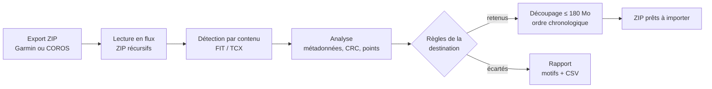

<p align="center">
  
</p>

# watch-relay

**Migrez l'historique de vos activités entre montres Garmin, COROS, Polar et Strava, sans qu'aucune donnée ne quitte votre navigateur.**

[](https://github.com/J-Dudek/watch-relay/actions/workflows/ci.yml)
[](https://github.com/J-Dudek/watch-relay/actions/workflows/security-scans.yml)
[](LICENSE)


watch-relay lit l'export de données d'un compte **Garmin**, **COROS**, **Polar** ou **Strava**, en extrait les fichiers d'activité
(`.fit`, `.tcx`), applique les contraintes de la plateforme de destination et produit des archives prêtes à
importer, accompagnées d'un rapport détaillé de ce qui a été retenu ou écarté, et pourquoi.

> Projet indépendant, non affilié à Garmin, COROS, Polar ni Strava. « Garmin », « COROS », « Polar » et « Strava » sont des marques de leurs propriétaires respectifs.

## Sommaire

- [Pourquoi](#pourquoi)
- [Fonctionnalités](#fonctionnalités)
- [Fonctionnement](#fonctionnement)
- [Modèle de confiance et sécurité](#modèle-de-confiance-et-sécurité)
- [Architecture](#architecture)
- [Design system](#design-system)
- [Démarrage rapide](#démarrage-rapide)
- [Qualité et tests](#qualité-et-tests)
- [Référencement (SEO)](#référencement-seo)
- [Ligne de commande](#ligne-de-commande)
- [Valider sur un vrai export](#valider-sur-un-vrai-export)
- [Déploiement](#déploiement)
- [État du projet et limites connues](#état-du-projet-et-limites-connues)
- [Contribuer](#contribuer)
- [Sécurité](#sécurité)
- [Licence](#licence)

## Pourquoi

Changer de montre ne devrait pas coûter des années d'historique. Or l'import d'un historique est contraint :

| Plateforme de destination | Contraintes connues                                                                                                                                |
| ------------------------- | -------------------------------------------------------------------------------------------------------------------------------------------------- |
| **COROS Training Hub**    | `.fit`/`.tcx` ; fichier ≥ 20 Ko ; fichier et ZIP ≤ 200 Mo ; un sport non pris en charge fait échouer **tout** le ZIP ; import depuis un ordinateur |
| **Garmin Connect**        | `.fit` ≤ 50 Mo, `.gpx`/`.tcx` ≤ 25 Mo, moins de 99 999 points par fichier ; pas d'import de ZIP ; import depuis un ordinateur                      |

Les exports, eux, sont de gros ZIP (jusqu'à plusieurs Go) contenant des ZIP imbriqués. watch-relay automatise le tri,
le contrôle et le découpage.

## Fonctionnalités

- **Six trajets** : Garmin → COROS, COROS → Garmin, Polar → COROS, Polar → Garmin, Strava → COROS et Strava → Garmin, chacun avec ses règles et ses consignes d'import (choix de la source et de la destination dans l'interface).
- **Polar, source uniquement** : à ma connaissance, Polar Flow n'importe pas d'historique d'activités (seulement des itinéraires), donc Garmin → Polar et COROS → Polar n'existent pas ; les destinations Polar sont affichées comme indisponibles. Les séances Polar s'exportent une par une (TCX, FIT ou GPX) : regroupez-les dans un ZIP ; une séance exportée en plusieurs formats n'est comptée qu'une fois. L'**export global JSON de Polar** (un JSON par séance) est converti en TCX (trace GPS, fréquence cardiaque, cadence, calories) ; le schéma vient d'un convertisseur communautaire et n'est **pas validé sur un export récent** : les JSON de forme inattendue sont ignorés ou signalés, jamais convertis de travers.
- **Strava, source uniquement** : l'archive du compte Strava (Paramètres, Mon compte, Télécharger ou supprimer votre compte) se dépose telle quelle. Ses fichiers d'activité, souvent compressés (`.fit.gz`, `.gpx.gz`), sont **décompressés en flux** avec les mêmes garde-fous que les ZIP (ratio, taille par fichier et volume global comptés sur les octets réellement produits ; un gzip tronqué, corrompu ou imbriqué est ignoré sans interrompre le lot). `activities.csv` est lu pour retrouver le sport des activités dont le fichier ne l'indique pas (colonnes reconnues par leur contenu, en-têtes localisés) sans jamais écraser un sport lu dans le fichier. Les activités saisies à la main n'ont pas de fichier : elles sont comptées dans le rapport mais ne sont pas transférables. Le format de l'export n'est **pas validé sur de nombreux comptes** (voir les limites).
- **Reclassement de sport** : un sport non pris en charge par COROS (golf, kayak…) est écarté par défaut, mais l'analyse permet de le traiter comme un sport accepté (golf → marche) puis de relancer l'analyse. Sur un FIT d'origine, **seuls les octets du sport sont corrigés sur place** (messages `session`, `lap` et `sport`, sous-sport remis à « generic », CRC recalculé, taille inchangée) sans réécrire le fichier ; un GPX ou une séance Polar reçoit le sport dans son FIT converti ; un TCX d'origine n'est pas modifié. Cible limitée aux sports acceptés ; reclassement signalé dans le rapport.
- **Ligne de commande** : le même moteur est disponible sans navigateur (`packages/cli`, voir [Ligne de commande](#ligne-de-commande)), pour les très gros exports ou les scripts.
- **Lecture récursive et en flux** des archives, quelle que soit leur structure : les fichiers sont reconnus par leur
  **contenu** (octets magiques), jamais par leur nom ou leur extension.
- **Règles par destination** : taille, nombre de points, sports pris en charge, période, doublons (même sport, ± 2 s :
  on garde le fichier le plus complet).
- **Découpage** en archives ≤ 180 Mo **compressés** (taille mesurée par échantillonnage par type de fichier, avec repli prudent si une archive dépasse 198 Mo), en ordre chronologique, nommées de façon lisible
  (`coros-import-01-2019-03_2021-07.zip`).
- **GPX → FIT (COROS)** : COROS n'importe que FIT et TCX ; les activités GPX (ex. issues de Strava) sont converties en **FIT** avec l'encodeur officiel de Garmin (trace, altitude, fréquence cardiaque, cadence, distance cumulée), ce qui **conserve le sport** (marche, randonnée, natation, ski…) que le TCX réduirait à Course, Vélo ou « Autre ». Le GPX est lu sans parseur XML ni DTD, avec le sport déduit du fichier ou de son nom (ou d'`activities.csv` pour Strava). Une activité si courte que son FIT passerait sous les 20 Ko minimum de COROS reste en TCX plutôt que d'être écartée. Il en va de même pour les séances de l'export global Polar vers COROS. Vers Garmin, les GPX sont conservés tels quels. **Les FIT produits n'ont pas encore été validés par des imports réels dans COROS** (voir les limites).
- **Données de santé reconnues** : les fichiers de suivi quotidien, de sommeil, etc. sont comptés et signalés (et non traités comme « corrompus »). Ils ne sont pas transférés (COROS n'importe que des activités), mais une option explicite (désactivée par défaut) les extrait en **CSV lisibles**, dans une archive à part, pour un archivage personnel (les formats JSON de Garmin variant, les fichiers sont aplatis sans supposer de champs).
- **Rapport clair** : motifs d'exclusion en langage simple, répartition par sport et par année, export **CSV**
  (protégé contre l'injection de formule).
- **Robuste** : un fichier corrompu n'interrompt jamais le lot ; traitement annulable ; progression en direct.
- **Gros volumes** : traitement dans un Web Worker, stockage temporaire OPFS (repli mémoire), écran maintenu allumé.
- **PWA** : installable et utilisable **hors ligne** après la première visite.
- **Interface** FR / EN, mobile-first, thème **clair / sombre / auto** (bascule mémorisée localement), accessible (WCAG 2.2 AA).
- **Design** : l'interface repose sur [**design-j6n**](https://design.byj6n.fr) (voir [Design system](#design-system)).

## Fonctionnement



Le traitement se fait en **deux passes** sur l'archive source : la première collecte les métadonnées, la seconde
n'écrit que les fichiers retenus. Rien n'est conservé en mémoire entre les deux, ce qui permet de traiter des exports
bien plus gros que la mémoire disponible.

## Modèle de confiance et sécurité

L'argument central est vérifiable : **aucune donnée sortante**. Il n'y a ni serveur de traitement, ni compte, ni
cookie, ni traceur, ni ressource tierce.

| Garantie                   | Mise en œuvre                                                                                                                                                                                                                                                                                  |
| -------------------------- | ---------------------------------------------------------------------------------------------------------------------------------------------------------------------------------------------------------------------------------------------------------------------------------------------- |
| Zéro donnée sortante       | CSP `default-src 'none'`, `connect-src 'self'` ; test e2e qui échoue sur toute requête cross-origin ou non-GET pendant un traitement                                                                                                                                                           |
| Durcissement du navigateur | CSP stricte sans `unsafe-*`, **Trusted Types**, HSTS, COOP/COEP/CORP, Permissions-Policy minimale, `nosniff`, `no-referrer`                                                                                                                                                                    |
| Archives hostiles          | Limites sur le ratio de compression (100:1), la profondeur, le nombre d'entrées, la taille du répertoire central et le volume total ; octets réellement produits comptés (les tailles déclarées ne sont jamais crues) ; zip slip neutralisé par construction (les noms de sortie sont générés) |
| Fichiers forgés            | CRC FIT vérifié via le SDK officiel ; TCX sans parseur XML et sans DTD/entités (XXE, _billion laughs_) ; expressions régulières à temps linéaire ; plafond d'analyse mémoire                                                                                                                   |
| Aucune injection HTML      | Aucune donnée de fichier dans le DOM autrement qu'en texte ; `innerHTML` et `bypassSecurityTrust*` interdits par ESLint, tout comme `fetch`, `XMLHttpRequest`, `WebSocket`, `sendBeacon` et les cookies dans le code livré                                                                     |
| Chaîne d'approvisionnement | 9 dépendances runtime justifiées ; `npm audit` bloquant ; licences vérifiées ; SBOM CycloneDX ; actions CI épinglées par SHA ; Dependabot avec délai de carence                                                                                                                                |
| Pas de trace               | Stockage temporaire vidé au démarrage, à « Recommencer » / « Terminer », après un échec et à la fermeture de l'onglet (au mieux)                                                                                                                                                               |

Le code a fait l'objet d'un **fuzzing** (FIT, TCX, ZIP : 10 000 itérations par propriété), d'analyses **Semgrep** et
**OWASP ZAP baseline** en CI, et d'une **revue de sécurité indépendante** dont les constats vérifiés ont été corrigés
avec un test de non-régression chacun. Cette revue est automatisée : elle ne remplace pas une relecture humaine.

## Architecture

Monorepo npm :

```text
packages/engine   Moteur TypeScript pur, sans dépendance au DOM ni à Angular : utilisable sous Node et en Worker
  src/            scan (ZIP), fit / tcx (parseurs), rules/, profiles (une destination = un profil),
                  pipeline, batching, naming, report / csv, process (orchestrateur), sinks (mémoire, OPFS)
apps/web          Application Angular 22 (standalone, signals, zoneless) + Web Worker
  src/app/        parcours en 4 étapes, i18n à chargement différé, service worker et manifeste
  e2e/            Playwright : parcours, sécurité, hors ligne, accessibilité, clavier, responsive, visuel
security/         Source unique des en-têtes HTTP (CSP, HSTS, cache…)
scripts/          Post-build (CSP, _headers, service worker), serveur de prévisualisation, garde-fous
```

Choix structurants :

- **Moteur séparé de l'interface** : testable sans navigateur, réutilisable, et exécutable sous Node pour valider un export.
- **Profils de destination** (`profiles.ts`) : ajouter une plateforme, c'est déclarer ses règles, son préfixe d'archive et
  sa taille de lot, sans toucher au pipeline.
- **Règles composables** : une règle par fichier (`FileRule`) ou sur l'ensemble (`SetRule`), un test par règle.
- **Une seule source pour les en-têtes** : `security/headers.mjs` alimente le build, le serveur de test, `_headers` et les e2e.
- **Aucune ressource tierce** : ni CDN ni service de polices (Sora et IBM Plex Mono sont empaquetées par le build), CSS global (compatible `style-src 'self'`).

Dépendances runtime : Angular (4 paquets), `rxjs`, `tslib`, [`@zip.js/zip.js`](https://gildas-lormeau.github.io/zip.js/),
le [SDK FIT officiel de Garmin](https://developer.garmin.com/fit/overview/) et [`design-j6n`](https://design.byj6n.fr)
(feuilles de style et polices uniquement, aucun code exécuté côté client).

## Design system

L'interface utilise **[design-j6n](https://design.byj6n.fr)** (« Foulée »), le design system de l'auteur,
publié sur npm : tokens (`--j6n-*`), thème clair et sombre à parité, polices Sora et IBM Plex Mono auto-hébergées, et
composants (boutons, carte, alertes, étapes, accordéon, contrôle segmenté, lien d'évitement…).

- **Intégration** : `design-j6n/fonts.css` et `design-j6n/theme.css` sont chargés avant `apps/web/src/styles.css`, qui ne
  contient que la mise en page propre à l'application. Les polices sont empaquetées par le build (aucune requête tierce).
- **Thème** : « Auto » suit `prefers-color-scheme` ; « Clair » et « Sombre » posent `<html data-theme>`, attribut
  que design-j6n comprend. Le choix est mémorisé dans le navigateur (`localStorage`), jamais envoyé.
- **`theme.js` volontairement non chargé** : l'application n'utilise aucun de ses comportements dynamiques (onglets, menus,
  infobulles, toasts…), et le code livré reste ainsi sans script tiers, compatible avec la CSP stricte et Trusted Types.
- **Mise à jour** : `npm update design-j6n`, puis `npm run e2e:update -w @watch-relay/web` pour régénérer les captures.

## Démarrage rapide

Prérequis : **Node 22** (voir `.nvmrc`).

```bash
npm ci
npm start -w @watch-relay/web                     # développement (http://localhost:4200)

npm run build                                      # build de production + CSP + _headers + service worker
npm run serve:dist -w @watch-relay/web             # sert le build avec les vrais en-têtes (http://localhost:4300)
```

## Qualité et tests

| Commande                 | Rôle                                                                                                                    |
| ------------------------ | ----------------------------------------------------------------------------------------------------------------------- |
| `npm run lint`           | ESLint (typescript-eslint `strictTypeChecked`) + Prettier                                                               |
| `npm run typecheck`      | TypeScript strict                                                                                                       |
| `npm test`               | Vitest : moteur (dont tests de propriétés et fuzzing fast-check) et interface                                           |
| `npm run e2e`            | Playwright sur le **build de production** servi avec les en-têtes réels : Chromium, Firefox, WebKit, Pixel 7, iPhone 15 |
| `npm run lighthouse`     | Lighthouse CI mobile et bureau : Performance ≥ 95, Accessibilité 100, Best Practices 100, SEO ≥ 95                      |
| `npm run check:licenses` | Licences des dépendances runtime                                                                                        |
| `npm run sbom`           | SBOM CycloneDX                                                                                                          |

Les e2e couvrent notamment : le parcours dans chaque sens, l'absence de requête sortante, la CSP et Trusted Types,
le fonctionnement hors ligne, **axe-core** (0 violation WCAG 2.2 AA sur chaque écran, FR/EN, clair/sombre),
la navigation au clavier, l'absence de défilement horizontal et les cibles tactiles ≥ 44 px de 320 à 1280 px, et la
régression visuelle (références Linux/Chromium ; `npm run e2e:update -w @watch-relay/web` pour les régénérer).

**Intégration continue** (GitHub Actions) : lint, typecheck, tests, audit, licences, SBOM, e2e, Lighthouse, CodeQL,
Semgrep, ZAP baseline. Les commits suivent les [Conventional Commits](https://www.conventionalcommits.org/)
(vérifiés par commitlint).

## Référencement (SEO)

Le site est une application, mais chaque page a une **vraie URL** indexable (`/`, `/faq`, `/privacy`, `/legal`), pas un
fragment `#`. Le build (`scripts/postbuild-seo.mjs`) produit :

- un **fichier HTML par page** avec ses propres `<title>`, description, `canonical`, Open Graph et Twitter Card, et un
  contenu `<noscript>` lisible sans JavaScript ; l'accueil porte un bloc **JSON-LD** `WebApplication` ;
- **`sitemap.xml`** (URL absolues, `lastmod` = date du dernier commit) et **`robots.txt`** qui le référence ;
- **`_redirects`** (chaque page servie par son fichier, URL inchangée) et **`404.html`** : une adresse inconnue renvoie une
  vraie 404 en `noindex`, pas une « soft 404 » ;
- le `Canonical` de `/.well-known/security.txt` ;
- hors production (aperçus de déploiement, branches), `robots.txt` interdit tout et `X-Robots-Tag: noindex` est ajouté.

L'**URL du site** vient de `SITE_URL`, sinon de la variable `URL` que Netlify fournit au build (domaine principal). Sans
URL absolue, le build l'indique et ne génère ni sitemap ni canonical. Pour la forcer : variable d'environnement
`SITE_URL=https://mon-domaine.tld` dans Netlify (_Site configuration → Environment variables_).

La navigation interne utilise l'History API (pas de rechargement : un traitement en cours est conservé) et les anciens liens
`/#/faq` sont redirigés. Le titre de l'onglet suit la page et la langue. Limite assumée : la langue se choisit côté client,
donc les moteurs de recherche voient la version française (pas d'URL ni de `hreflang` par langue).

Tests : `scripts/seo.test.mjs` (`npm run test:scripts`) pour les fonctions pures, `e2e/seo.spec.ts` sur le build réel.

## Ligne de commande

Le moteur tourne aussi sous Node (≥ 22), sans navigateur ni serveur : mêmes règles, mêmes rapports, rien n'est envoyé.

```bash
npm run build -w watch-relay                       # produit packages/cli/dist/watch-relay.mjs
node packages/cli/dist/watch-relay.mjs export.zip  # Garmin → COROS, archives dans ./watch-relay-out

watch-relay export.zip --from strava --to garmin --out sortie/
watch-relay export.zip --dry-run                   # rapport seulement, rien n'est conservé
watch-relay export.zip --since 2020-01-01 --until 2022-12-31
watch-relay export.zip --reclassify golf=walking   # traite un sport écarté comme un sport accepté
watch-relay export.zip --json --report rapport.csv # JSON sur stdout, CSV détaillé
```

`--from` : `garmin` (défaut), `coros`, `polar`, `strava` ; `--to` : `coros` (défaut) ou `garmin`. `--verbose` liste tous
les fichiers écartés (10 par motif sinon). Codes de sortie : `0` succès, `1` erreur de traitement, `2` usage
incorrect, `3` aucune activité importable, `130` interrompu. Le paquet est marqué `private` : sa publication sur npm
(`npx watch-relay`) reste à décider (nom, licence), puis retirer `private` de `packages/cli/package.json`.

## Valider sur un vrai export

Les exports réels ne vont jamais dans le dépôt (`/local-data/` est ignoré ; un hook et la CI refusent les `.fit`,
`.tcx`, `.gpx` et `.zip` hors `fixtures/`). Pour passer un export dans le moteur, sous Node, sans rien envoyer :

```bash
npm run inspect:export -- local-data/export-garmin.zip                          # vers COROS
npm run inspect:export -- local-data/export-coros.zip --target garmin           # vers Garmin
npm run inspect:export -- local-data/export-strava.zip --source strava          # export Strava (sports du CSV)
npm run inspect:export -- local-data/export-garmin.zip --out local-data/sortie  # écrit les ZIP pour un import manuel
```

Le rapport est **anonyme** : aucun nom de fichier ni donnée d'activité, seulement des comptes, des motifs d'exclusion,
des sports, des années, la durée et le pic de mémoire.

## Déploiement

Site statique : aucune fonction, aucune base de données. Le dépôt est prêt pour **Netlify** (`netlify.toml`) :

- commande `npm run build`, dossier publié `apps/web/dist/web/browser`, Node 22 ;
- le build écrit `_headers` (CSP, HSTS, COOP/COEP, `no-cache` sur le HTML et `sw.js`) à partir de `security/headers.mjs` ;
- le post-traitement Netlify est désactivé pour ne pas altérer les fichiers au hash ni le service worker.

Un autre hébergement statique convient : `node scripts/postbuild-security.mjs <dossier> --caddy` génère un extrait
Caddy équivalent. Après mise en ligne, vérifier les en-têtes sur toutes les réponses (y compris le worker) et mesurer
Mozilla Observatory et securityheaders.com.

## État du projet et limites connues

Le moteur, l'application (parcours, i18n, PWA, pages d'information), le durcissement et les tests sont en place.
Ce qui reste à valider, par honnêteté :

- **Règles COROS provisoires** : la liste des sports acceptés par COROS doit être confirmée par des imports réels.
- **Export COROS** : son contenu exact n'est pas documenté ; le moteur lit n'importe quelle structure, mais cela doit
  être confirmé sur un vrai export. Les limites Garmin (nombre de fichiers par import, sports acceptés) ne sont pas
  toutes documentées.
- **FIT produits par conversion (GPX, Polar → COROS)** : relus et vérifiés (CRC, sport, nombre de points) par le décodeur officiel dans les tests, mais pas encore importés dans un vrai compte COROS. Importer d'abord un petit lot, puis vérifier le sport et la trace de la première activité.
- **Export Strava** : structure (dossier `activities/`, `.gz`, colonnes d'`activities.csv`) décrite d'après la documentation et des exports connus, à confirmer sur de vrais comptes ; la correspondance des types d'activité Strava vers les sports (EN/FR) est volontairement prudente et ne devine pas les types inconnus.
- **Appareils réels** : OPFS n'a pas été vérifié sur un vrai iPhone ; en repli mémoire, un export de plusieurs Go peut
  faire échouer l'onglet. Les tests sur appareils physiques restent à faire.
- **Pas de délai maximal strict par fichier** : le décodage est synchrone ; des plafonds de mémoire et d'entrée limitent
  le risque sans l'éliminer.
- **Accessibilité** : les contrôles automatisés ne remplacent pas un test avec lecteur d'écran (VoiceOver, NVDA).
- Les captures de référence visuelles sont produites sous Linux : les régénérer depuis la CI si les polices diffèrent.

## Contribuer

Les contributions sont bienvenues, en particulier **des retours d'imports réels** (règles acceptées ou refusées par
COROS et Garmin Connect) via une issue, sous forme de rapport anonyme (`inspect:export`).

1. `npm ci` (les hooks Husky lancent Prettier, ESLint et commitlint).
2. Une règle ou un comportement = un test. Les changements visuels demandent de régénérer les références.
3. `npm run lint && npm run typecheck && npm test && npm run e2e` doivent passer.
4. Commits en Conventional Commits ; aucune donnée personnelle ni export réel dans le dépôt.

## Sécurité

Pour signaler une vulnérabilité, **n'ouvrez pas d'issue publique** : voir [`SECURITY.md`](SECURITY.md)
(engagements : accusé de réception sous 7 jours, réponse sous 90 jours). Le contact est aussi publié dans
`/.well-known/security.txt`.

## Licence

[MIT](LICENSE) © 2026 Julien Dudek. Le SDK FIT de Garmin est utilisé selon sa propre licence.

---

Conçu et maintenu par [**J6N**](https://me.byj6n.fr).
